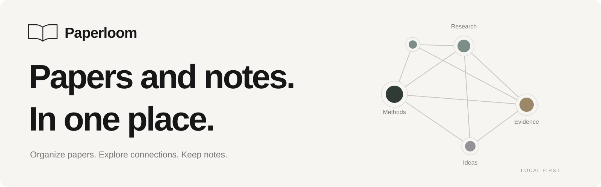
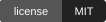
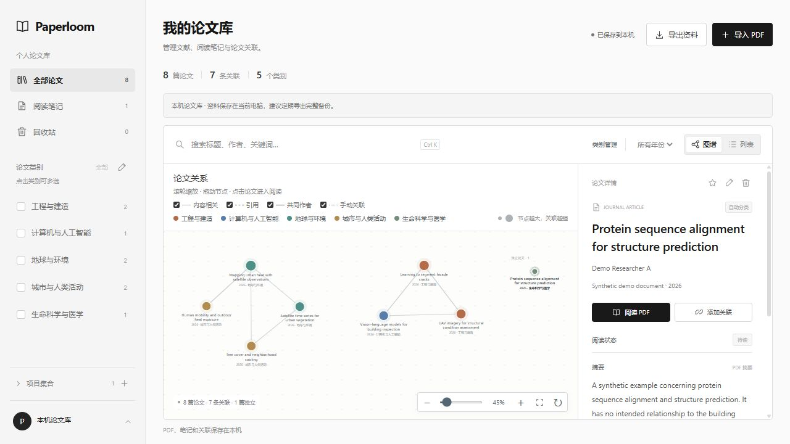
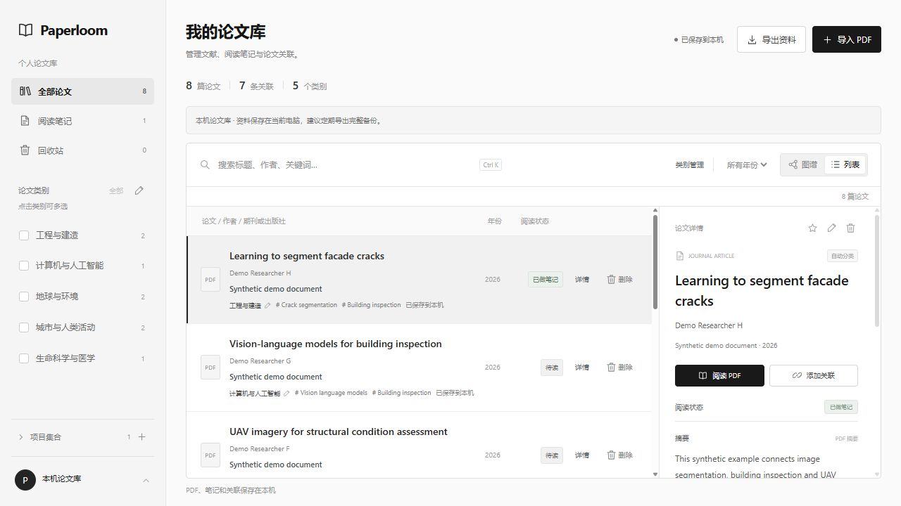
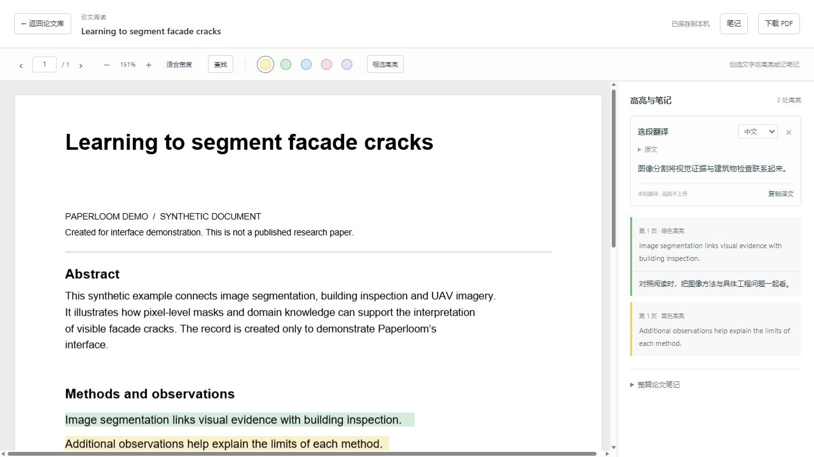

<p align="center"></p>

<p align="center"><strong>Keep your papers and reading notes together.</strong><br>Organize your library, explore connections, and capture ideas as you read.</p>

<p align="center">
 <a href="LICENSE"></a>
 
 
 
</p>

<p align="center"><a href="README.md">简体中文</a> · English<br><a href="#quick-start">Quick start</a> · <a href="#features">Features</a> · <a href="#data--privacy">Data &amp; privacy</a> · <a href="#roadmap">Roadmap</a> · <a href="CONTRIBUTING.md">Contribute</a></p>

---

**Paperloom brings your papers, their connections and your reading notes together.** Import existing papers, organize them into editable research categories, explore related work in an interactive graph, and read, highlight, annotate, search and translate passages in one place.

Built for literature reviews, research projects and the everyday work of finding a paper you remember reading.

<p align="center"><br><sub>Real application screenshots. All papers, authors and notes shown are synthetic demonstration content.</sub></p>

## Features

| Workflow                | What is available                                                                                                                                                        |
| ----------------------- | ------------------------------------------------------------------------------------------------------------------------------------------------------------------------ |
| **Import & organize**   | Batch PDF import, visible progress, duplicate detection and extraction of available titles, abstracts, DOI, keywords, author metadata, years and publication information |
| **Editable categories** | Broad research categories, custom names and colors, editable paper membership, multi-category filtering and project collections                                          |
| **Explore connections** | Category colors, node size based on relationship strength, cross-category relationships, zoom, pan, draggable nodes and isolated papers                                  |
| **Read & annotate**     | Continuous PDF pages, zoom, page navigation, five translucent highlight colors, area highlights, passage notes and paper notes                                           |
| **Search & translate**  | Full-document text search with page navigation; Chinese–English passage translation on supported desktop browsers, on-device, without a translation API key              |
| **Keep your work**      | SQLite metadata and notes, PDF files on disk, automatic saving, version conflict checks, recoverable trash and full backup export/import                                 |

<table><tr><td width="50%"><br><strong>Find a paper</strong><br><sub>Categories, publication details and reading activity.</sub></td><td width="50%"><br><strong>Keep an idea</strong><br><sub>Lightweight highlights, with notes when you need them.</sub></td></tr></table>

## Quick start

Install **Node.js 24.15 or newer**. Node.js 24 LTS is recommended. Download this repository through **Code → Download ZIP**, extract it, and open a terminal in the project directory, or clone the repository.

To clone the repository first:

```bash
git clone https://github.com/Whitneyyyyy/paperloom.git
cd paperloom
```

```bash
npm start
```

Open **http://127.0.0.1:3000** and import a PDF. The database and file directory are created automatically.

There are no npm runtime dependencies to install and no build step. You can also run the server directly:

```bash
node server/index.mjs
```

To explore a synthetic sample library, stop the running server and use:

```bash
npm run demo
```

The demo creates eight original synthetic PDFs in the separate `data/demo/` directory. Stop it and run `npm start` to return to your own library in `data/`. Demo setup refuses to add examples to a directory containing personal records.

> This repository ships a **local, single-user edition**. Public registration, multi-user hosting and automatic cloud synchronization are roadmap items. The server binds only to `127.0.0.1`.

## How the graph works

- **Content relationships** use text features from titles, abstracts, keywords and domain concepts. They are reading suggestions, not evidence that conclusions agree.
- **Citation edges** require a parsed reference DOI matching a paper in your library. Missing citations are not invented.
- **Shared-author edges** match available author names. They do not perform identity disambiguation.
- **Manual relationships** preserve your own observations.

Colors represent editable broad categories. Node size reflects weighted relationship strength. Being in the same category alone does not force a connection; unrelated papers remain independent nodes.

## Data & privacy

By default, the application stores metadata and notes in `data/paperloom.sqlite` and PDFs under `data/files/`. Browser caches support retries and pending changes. Closing the browser or restarting the server does not remove saved files.

Use **Export → Full backup** to include PDFs, metadata, categories, highlights, notes and manual connections. To copy the raw data directory, stop the server first. Trash preserves the original PDF and notes for recovery and does not immediately reclaim file space.

| Operation                                                      | Where it happens                                                                                                                                  |
| -------------------------------------------------------------- | ------------------------------------------------------------------------------------------------------------------------------------------------- |
| PDF parsing, classification, graph computation and text search | In your browser                                                                                                                                   |
| Saving PDFs, metadata and notes                                | Your local server on this computer                                                                                                                |
| Translation                                                    | On-device through a supported browser's Translator API; the browser downloads language packs initially                                            |
| Missing publication details                                    | Optional server-side DOI lookup through [Crossref](https://www.crossref.org/documentation/retrieve-metadata/rest-api/); no PDFs or notes are sent |

There is no MyMemory integration or paid LLM translation API. Set `PAPERLOOM_CROSSREF=off` to disable DOI lookup.

## Configuration

Copy `.env.example` to `.env` and start with:

```bash
node --env-file=.env server/index.mjs
```

| Variable             | Default  | Purpose                                           |
| -------------------- | -------- | ------------------------------------------------- |
| `PAPERLOOM_PORT`     | `3000`   | Local port                                        |
| `PAPERLOOM_DATA_DIR` | `./data` | Data directory, relative to the working directory |
| `PAPERLOOM_CROSSREF` | `on`     | Set to `off` to disable Crossref requests         |

The local server rejects unexpected Host headers and cross-origin write requests. It has a local single-user identity rather than public account authentication. Do not expose it directly through a tunnel or reverse proxy. Public hosting needs an authentication adapter, authorization, quotas and operational controls.

See the [deployment guide](docs/DEPLOYMENT.md) and [architecture notes](docs/ARCHITECTURE.md).

## Current scope

- Text-layer PDFs; OCR is planned. Each PDF may be up to 30 MiB.
- Rule-based metadata extraction depends on the source PDF; fields remain editable.
- Up to 1,000 highlights per paper, also subject to the 2 MiB metadata request limit.
- Passage translation requires a compatible desktop Chrome or Edge; mobile is not supported. First use downloads a model. Selections are capped at 3,000 characters and remain subject to the browser model's input limit.
- No fixed paper-count cap; large-library performance has not been benchmarked. Relationships currently compare paper pairs, so pagination and background computation remain important work.
- Storage depends on your available disk space; no capacity dashboard yet.
- The current interface is primarily in Chinese. English interface localization is welcome.

## Development

```bash
npm run dev
npm test
npm run check
npm run prepare:client
```

Native ES modules power the UI. The backend uses Node.js HTTP, built-in SQLite and a private file directory. PDF.js is distributed with the project. Shared business logic is separated from storage and request-identity adapters.

```text
public/       UI, graph, PDF reader and browser cache
lib/          Classification, relationships, annotations, search and service API
server/       Local HTTP server, SQLite and file-storage adapter
drizzle/      Sequential SQL migrations
scripts/      Client sync, demo generation and repository checks
tests/        Business rules and real local-server tests
docs/         Guides, architecture and screenshots
examples/     Synthetic demo records
```

## Roadmap

- [x] Standalone local server and automatic database initialization
- [x] PDF import, broad categories and editable classification
- [x] Interactive relationship graph and independent nodes
- [x] Reading, highlights, notes, text search and on-device translation
- [x] Persistence, conflict checks, trash and full backups
- [ ] Large-library pagination, background computation and benchmarks
- [ ] OCR, richer metadata sources and author disambiguation
- [ ] Capacity reporting, file cleanup and backup management
- [ ] Docker packaging, authentication adapters and multi-user hosting
- [ ] Zotero, BibTeX and RIS integration
- [ ] English interface localization

## Contributing

Bug reports, workflow ideas, documentation improvements and pull requests are welcome. The synthetic demo is a useful way to reproduce issues without sharing private papers. See [CONTRIBUTING.md](CONTRIBUTING.md) and [SECURITY.md](SECURITY.md).

**If Paperloom makes your research library a little easier to use, a Star helps others discover it.**

## License & acknowledgments

[MIT License](LICENSE) · Paperloom contributors. Third-party components retain their own licenses; see [THIRD_PARTY_NOTICES.md](THIRD_PARTY_NOTICES.md). Demo material is original synthetic content and contains no user records.
