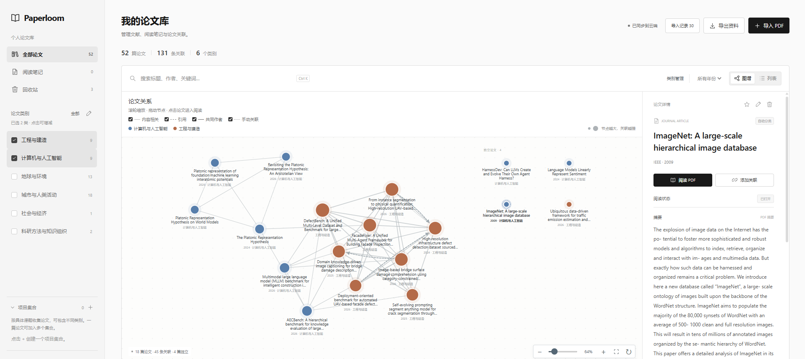
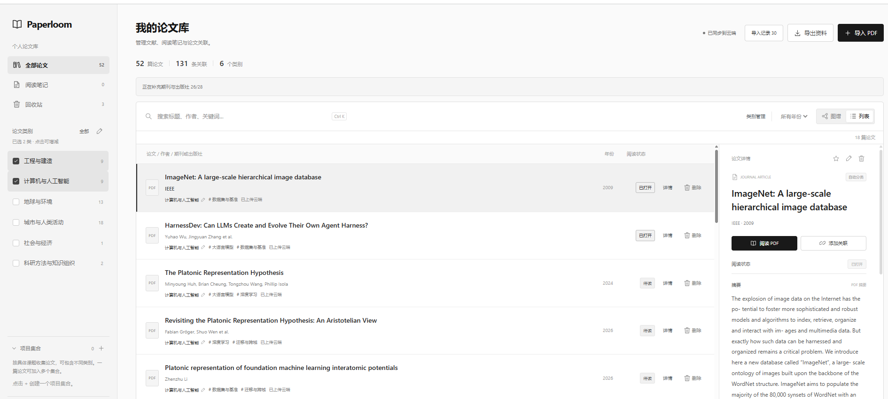

<p align="center">
  
</p>

<p align="center">
  <strong>让散落的论文，成为相互关联的研究资料。</strong><br>
  整理论文 · 探索关系 · 阅读高亮 · 选段翻译
</p>

<p align="center">
  <a href="LICENSE"></a>
  <a href="https://nodejs.org/"></a>
  
  
</p>

<p align="center">
  简体中文 · <a href="README.en.md">English</a><br>
  <a href="#快速开始">快速开始</a> · <a href="#能做什么">功能</a> · <a href="#数据与隐私">数据与隐私</a> · <a href="#项目路线图">路线图</a> · <a href="CONTRIBUTING.md">参与贡献</a>
</p>

---

**Paperloom 是一个本地优先的论文管理工具。** 上传已有 PDF，自动提取信息、按研究大类整理；在列表中查找文献，在关系图中探索联系，再进入同一个阅读器做高亮、笔记、全文搜索与中英选段翻译。

适合正在做文献综述、整理研究方向，或希望把“下载过的论文”变成“用得上的资料”的人。

<p align="center">
  <br>
  <sub>图谱与列表截图来自在线版；本仓库提供本机单人版本，资料保存在当前电脑。</sub>
</p>

## 为什么做 Paperloom

读过一篇论文后，我们往往记得它的一点启发，却忘了文件放在哪里；下载的文献越来越多，它们之间的联系也容易埋在文件夹里。

Paperloom 把三个步骤放到一起：**整理好、连起来、读进去。** 列表保留查找文件的效率，图谱帮助发现值得对照阅读的文章，阅读器则承接高亮和想法。

## 能做什么

| 工作流             | 已实现的功能                                                                                                    |
| ------------------ | --------------------------------------------------------------------------------------------------------------- |
| **导入与整理**     | 批量导入 PDF；展示读取、识别、保存进度；重复文件检测；提取标题、摘要、DOI、关键词及可识别的作者、年份与出版信息 |
| **可编辑分类**     | 使用少量研究大类；修改名称和颜色；调整每篇文章归属；同时筛选多个类别；按课题建立项目集合                        |
| **交互关系图**     | 类别颜色、按关联强度缩放节点、跨类别联系；滚轮缩放、画布平移、节点拖动；保留无关联的独立论文                    |
| **连续 PDF 阅读**  | 多页阅读、缩放、页码跳转；五种半透明高亮；文字划选与区域标注；高亮笔记和整篇笔记                                |
| **搜索与翻译**     | 文内关键词查找、跨页跳转；支持的桌面浏览器在设备内完成中英翻译，无需翻译 API Key                                |
| **持久保存与备份** | SQLite 保存元信息与笔记，文件目录保存 PDF；自动保存、修改版本检查、回收站恢复；完整备份导出与恢复               |

<table>
  <tr>
    <td width="50%"><br><strong>查找一篇论文</strong><br><sub>分类、作者、期刊、关键词与阅读记录放在一起。</sub></td>
    <td width="50%"><br><strong>留下一点想法</strong><br><sub>高亮保持轻量，想写笔记时再展开。</sub></td>
  </tr>
</table>

## 快速开始

需要 **Node.js 24.15 或更新版本**，推荐使用 [Node.js 24 LTS](https://nodejs.org/)。Windows、macOS 和 Linux 都可以使用。

### 1. 下载项目

在仓库顶部选择 **Code → Download ZIP**，解压后打开项目文件夹的终端；也可以克隆：

```bash
git clone https://github.com/Whitneyyyyy/paperloom.git
cd paperloom
```

### 2. 启动

```bash
npm start
```

然后在浏览器打开 **http://127.0.0.1:3000**。

首次启动会自动创建数据库和文件目录。这个版本没有需要安装的 npm 运行依赖，也不需要构建步骤；也可以直接运行：

```bash
node server/index.mjs
```

### 3. 导入自己的 PDF

点击 **导入 PDF**，选择文件或拖入 PDF。等待任务显示保存完成，之后就可以在列表或图谱中浏览。

想先看效果？先停止已运行的服务，再启动演示：

```bash
npm run demo
```

它会在独立的 `data/demo/` 目录生成 8 篇合成演示论文并启动页面。停止演示后运行 `npm start`，回到自己的 `data/` 论文库。演示命令不会向已有的个人论文库插入样例。

> 此仓库提供可直接运行的**本机单人版本**。公共注册、多人云端部署与自动跨设备同步列入路线图；当前服务固定监听 `127.0.0.1`。

## 一个顺手的使用过程

1. **导入**：读取 PDF 文字和元信息，自动分类并建立内容关联。
2. **整理**：修改类别名称与归属，把跨方向文献放进同一个项目集合。
3. **探索**：同时选择几个类别，在图谱中缩放、拖动，寻找可对照阅读的文章。
4. **阅读**：点击论文打开 PDF，搜索关键词、标记段落，有想法时再补笔记。
5. **带走**：导出“完整备份（含 PDF）”，在另一份 Paperloom 中恢复。

阅读状态自动记录为“待读 / 已打开 / 已做笔记”，无需维护一套手动状态。

## 图谱的连线来自哪里

| 连线     | 依据                                     | 应如何理解                               |
| -------- | ---------------------------------------- | ---------------------------------------- |
| 内容相关 | 标题、摘要、关键词和领域概念的文本特征   | 提供对照阅读线索，不代表结论一致         |
| 引用     | 解析出的参考文献 DOI 与库中论文 DOI 匹配 | 只在能匹配时生成，不补造引用关系         |
| 共同作者 | 已识别作者姓名相同                       | 姓名可能重名，不是经过作者身份消歧的结果 |
| 手动关联 | 用户主动添加的关系与说明                 | 保存自己的阅读判断                       |

节点颜色表示研究大类；节点大小表示加权关联强度。仅属于同一个大类不会自动强连，无关联文章会独立保留。

## 数据与隐私

### 资料存在哪里

默认保存到项目根目录的 `data/`：

```text
data/
├── paperloom.sqlite      # 论文、类别、笔记、关联与迁移记录
├── paperloom.sqlite-wal  # 运行时可能存在的 SQLite 日志
└── files/               # PDF 原文件
```

- 关闭页面或重启服务，不会清空已经保存的数据。
- 浏览器还保留缓存与未完成操作；清除缓存不会删除已写入数据目录的资料。
- 回收站会保留 PDF 和笔记，方便恢复；移入回收站不会立即释放原文件空间。
- 推荐通过界面导出完整备份。复制整个数据目录时，请先停止服务。
- 数据目录、PDF、环境配置与凭据已由 `.gitignore` 排除；公开仓库包含代码、合成样例和界面截图，不含个人论文原文件或运行数据。

### 有哪些网络请求

| 内容                           | 处理方式                                                                                                                            |
| ------------------------------ | ----------------------------------------------------------------------------------------------------------------------------------- |
| PDF 解析、分类、图谱、文内搜索 | 浏览器内处理                                                                                                                        |
| PDF、元信息、笔记保存          | 当前电脑的本地服务                                                                                                                  |
| 选段翻译                       | 支持的浏览器在本机推理；首次由浏览器下载语言模型                                                                                    |
| DOI 出版信息补全               | 缺少来源信息时，服务端向 [Crossref](https://www.crossref.org/documentation/retrieve-metadata/rest-api/) 查询 DOI；不发送 PDF 或笔记 |

不使用 MyMemory 或付费大模型翻译接口。需要禁止 DOI 查询时，将 `PAPERLOOM_CROSSREF` 设置为 `off`。

## 配置与部署

复制 `.env.example` 为 `.env`，按需调整后启动：

```bash
node --env-file=.env server/index.mjs
```

| 环境变量             | 默认值   | 用途                           |
| -------------------- | -------- | ------------------------------ |
| `PAPERLOOM_PORT`     | `3000`   | 本机端口                       |
| `PAPERLOOM_DATA_DIR` | `./data` | 数据目录，相对于启动时所在目录 |
| `PAPERLOOM_CROSSREF` | `on`     | 设置 `off` 关闭 DOI 在线补全   |

此版本采用本机单人身份，固定绑定回环地址，并拒绝不匹配的 Host 与跨来源修改请求。要部署为公共服务，需要额外实现真实身份认证、访问授权、配额及运维机制；请勿通过隧道或反向代理直接公开这个单人接口。

详细步骤、备份和常见问题见 [安装与部署指南](docs/DEPLOYMENT.md)。

## 当前边界

| 项目     | 当前行为                                                                                                              |
| -------- | --------------------------------------------------------------------------------------------------------------------- |
| PDF      | 单文件最多 30 MiB；支持有文字层的 PDF；OCR 尚未实现                                                                   |
| 元信息   | 基于规则与 PDF 文字/属性识别，完整性受原文件影响；可手动编辑                                                          |
| 文献数量 | 未设置固定篇数上限；尚未承诺大规模库的性能，关联目前按文章两两比较                                                    |
| 高亮     | 每篇最多 1,000 处；每次元信息请求最多 2 MiB，实际也受笔记内容大小影响                                                 |
| 翻译     | 需要支持 Translator API 的桌面 Chrome / Edge；首次下载模型；不支持时给出提示；每次最多 3,000 字符，仍受浏览器模型限制 |
| 容量     | 取决于本机磁盘可用空间；尚无内置容量仪表盘                                                                            |
| 多人使用 | 开源版本当前为本机单人模式                                                                                            |

## 开发

```bash
npm run dev             # 监视服务端模块并自动重启
npm test                # 分类、图谱、数据隔离、持久化、阅读、翻译与接口测试
npm run check           # 检查语法、公开包边界、共享模块和文档资源
npm run prepare:client  # 修改 lib/ 共享模块后同步浏览器副本
```

应用使用原生 ES modules、Node.js 内置 HTTP/SQLite 与文件存储，以及随项目分发的 PDF.js。服务与存储接口分离，方便后续替换部署适配器。

```text
public/       页面、列表、图谱、PDF 阅读器与浏览器缓存
lib/          分类、关系、标注、搜索、翻译与数据接口
server/       本地 HTTP 服务、SQLite 与 PDF 文件适配器
drizzle/      顺序执行的 SQL 迁移
scripts/      共享模块同步、合成演示与仓库检查
tests/        业务规则与真实本地服务测试
docs/         部署、架构、发布说明与功能截图
examples/     合成演示数据
```

设计与数据流见 [架构说明](docs/ARCHITECTURE.md)。

## 项目路线图

- [x] 独立本机启动与自动数据库初始化
- [x] PDF 导入、自动大类整理、可编辑分类
- [x] 交互关系图与独立节点
- [x] 阅读、高亮、笔记、文内查找、本机选段翻译
- [x] 持久保存、版本冲突检查、回收站与完整备份
- [ ] 大型文献库分页、后台图谱计算与性能基准
- [ ] OCR、更多元信息来源与作者消歧
- [ ] 容量统计、文件清理与备份管理
- [ ] Docker 打包、认证适配器与多人部署
- [ ] Zotero / BibTeX / RIS 等格式集成

## 一起完善

欢迎报告识别错误、提交改进建议，或贡献代码。复现问题时可以优先使用 `npm run demo` 的合成文献，避免附带私人论文和笔记。

详见 [贡献指南](CONTRIBUTING.md) 与 [安全说明](SECURITY.md)。

**如果 Paperloom 让你的文献整理更顺手，欢迎点一颗 Star。** 也欢迎在 Issue 中分享你希望它支持的研究工作流。

## 许可与致谢

[MIT License](LICENSE) · Paperloom contributors。PDF.js 等第三方组件保留各自许可证，见 [第三方说明](THIRD_PARTY_NOTICES.md)。演示内容由项目原创生成，不包含真实用户资料。
