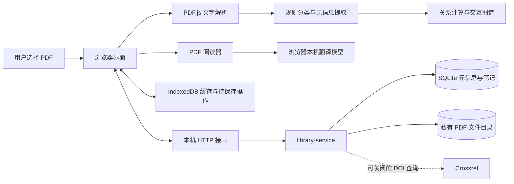

# 架构与数据流

## 三层结构

1. **界面与浏览器工作**：`public/` 使用原生 ES modules。PDF.js 解析和呈现 PDF，文本特征用于分类与关联。临时搜索标记与永久高亮相互独立。
2. **业务接口**：`lib/library-service.mjs` 使用标准 Request / Response，校验当前身份、输入大小、版本号、文件类型与指纹。每条记录按 `owner_id` 读写。
3. **部署适配**：`server/` 把 Node.js HTTP 请求转为 Web Request，把 SQLite 和磁盘目录适配为 DB / BUCKET 接口，并提供单人本机身份。

## 保存行为

- 保存论文使用版本号，过时修改不会静默覆盖新版本。
- PDF 原文件单独保存，文件路径由 owner 的哈希、论文 ID 和 PDF 指纹组成。
- 文件先写临时文件，再重命名到最终位置。
- 删除写入 `deleted_at`，恢复保留 PDF、笔记和阅读记录。
- 浏览器在网络不可用时保留待保存操作，服务恢复后重试。
- 自动分类与图谱不使用远程 LLM。翻译仅调用浏览器的 Translator API。

## 本地访问边界

服务只监听 `127.0.0.1`，拒绝未预期 Host，写操作检查来源。仅 `public/` 内的文件可作为静态资源读取，私有数据目录不作为静态目录提供。客户端传来的身份或转发头不作为授权依据。

本机身份由实例自己生成并保存，不等于公网认证。同一电脑上能访问该本机服务的进程属于其信任范围。

## 扩展方向

- 多人部署：替换可信身份解析与运行入口，保留每次服务端 owner_id 授权；不要信任未经验证的代理身份头。
- 云存储：替换 DB / BUCKET 适配器，增加配额、备份、删除回收与运行监控。
- 大型库：目前读取全库，内容关联按论文两两比较；分页、增量索引和后台任务优先于扩大公开容量承诺。
- 标注：高亮使用页面归一化坐标，缩放不会改变其语义位置。
- 元信息：PDF 规则解析可逐步加入 DOI 来源与其他标准化来源；始终保留用户编辑。

## 浏览器共享模块

`scripts/prepare-client.mjs` 同步 `lib/` 中的共享逻辑到 `public/`。修改后运行 `npm run prepare:client`；仓库检查会验证这些副本一致。
